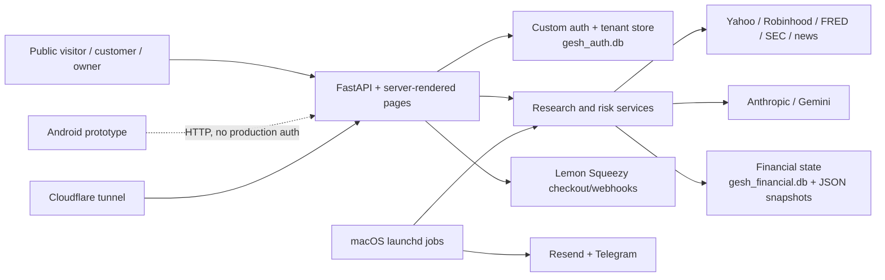

# GESH Financial — Executive Product and Engineering Audit

**Audit date:** 2026-07-18
**Audited revision:** `dc9692647a3ccf7ae47c9b1ca49faab2fe4901ae` (`main`)
**Scope:** product, web and Android clients, APIs, calculations, data, AI, billing, security, privacy, operations, tests, and launch readiness.
**Rule:** open pull requests—including #93, #95, and #96—are treated as unshipped.

## Executive verdict

GESH is a broad and unusually honest **owner-operated financial research system** with a credible paid-beta foundation. It is not yet a production-ready consumer fintech product or a reliable portfolio-accounting system.

| Decision | Verdict | Reason |
|---|---|---|
| Demo readiness | **Ready** | Public login, pricing, track-record and protected-app surfaces run; the product has substantial real workflows. |
| Selected beta users | **Conditionally ready** | Suitable for a small, informed, manually supported cohort using it as research—not advice or a performance ledger—after the immediate operational and disclosure fixes. |
| Public paying-user launch | **Not ready** | Draft/unreviewed legal terms, no privacy/deletion/export program, personalized-looking investment outputs, weak recovery/observability, unresolved data-quality defects, and incomplete customer lifecycle tooling. |
| Financial-calculation reliability | **Mixed** | Several deterministic formulas have strong invariant tests; customer performance/accounting is absent, AI-derived metrics are not auditable valuations, and legacy paper-trade/ECG paths are unreliable. |
| Live trading | **Intentionally unavailable** | `trading/execution.py` refuses live execution and defaults are paper/approval-safe. Do not market broker execution. |

**Recommended positioning now:** “decision-integrity research beta” for self-directed investors who want explicit assumptions, scenario ranges, a decision journal, and simulated evidence. Do not lead with signal accuracy, personalized allocation, tax advice, or predictive certainty.

## Maturity assessment

| Dimension | Maturity | Evidence-based assessment |
|---|---:|---|
| Product breadth | 3/5 | Any-ticker research, manual portfolio, consensus, risk, Kelly, Monte Carlo, alerts, digest, proof page, billing and owner operations exist. |
| Customer workflow | 2/5 | Customer isolation is strong, but onboarding, risk-profile capture, brokerage import, transactions, account management, billing portal and support tooling are incomplete. |
| Financial correctness | 2/5 | Fair-value convention, risk bands, trade-level ordering and Monte Carlo invariants are tested; user return accounting is missing and several high-trust outputs are heuristic or AI-generated. |
| Security engineering | 3/5 | Auth wall, PBKDF2, signed single-use magic links, generic errors, webhook HMAC and tenant tests are strong. Sensitive file permissions, session revocation, CSP, mobile cleartext and privacy governance remain gaps. |
| Reliability/operations | 2/5 | launchd automation and health summaries exist, but this is a single-Mac deployment with `/tmp` logs, upstream-data failures, no restore-tested backups/staging/rollback, and a latest failed billing reconcile. |
| Verification | 3/5 web / 1/5 Android | 1,214 Python tests pass at 56% coverage. Public browser QA passed. Protected-role E2E is not verified. Android builds but has zero tests and cannot use production auth. |
| Commercial readiness | 2/5 | Hosted checkout and resilient webhook provisioning are solid. Self-service billing, refunds, privacy/compliance review and support operations are missing. |

## What is strongest

1. **Honest proof surface.** `/track-record` separates engine and manual cohorts, labels simulation and fails the autonomy gate rather than hiding weak evidence (`proof_page.py`; `trade_log.py`).
2. **Customer isolation.** Session-derived tenant keys, owner-dollar masking, customer leak sweeps and explicit XSS wiring tests materially reduce cross-customer exposure (`auth.py`, `auth_users.py`, `server.py`, `tests/test_customer_leak_sweep.py`).
3. **Billing webhook engineering.** Raw-body HMAC verification, strict variant allowlisting, leased idempotency, event ordering and a reconciliation path are unusually mature for the product stage (`billing.py`, `billing_reconcile.py`, `tests/test_billing*.py`).
4. **Deterministic safety core.** Trade contracts, persisted gate decisions, paper defaults, kill switch, confidence/cash/freshness/daily-loss controls and strict level ordering are testable and inspectable (`trading/`, `trade_levels.py`).
5. **Property/invariant testing.** Money masking, fair-value convention, Kelly caps, trade-level ordering and Monte Carlo math have meaningful adversarial coverage (`tests/test_*invariant*.py`, `tests/test_financial_properties.py`).
6. **AI cost and schema controls.** Bounded calls, usage logging, structured output schemas and quota controls are better than free-form AI plumbing (`ai_analyzer.py`, `ai_usage.py`, `auth_users.py`).

## Product and system shape

This is not the React/Next.js/PostgreSQL/Redis system described in stale context. The audited production application is primarily FastAPI, a roughly 4,500-line vanilla-JavaScript dashboard template, SQLite, JSON artifacts and macOS launchd. That mismatch is itself documentation debt.

## Highest risks

| Rank | Risk | Consequence | Evidence |
|---:|---|---|---|
| 1 | Legal posture contradicts product behavior | The draft terms say outputs are not personalized, while the service accepts a customer book and generates Kelly sizing, actions and “deploy cash” allocations. Paid launch has investment-adviser, advertising and consumer-protection risk requiring counsel. | `TERMS_OF_SERVICE.md:3-5,24-35`; `server.py` customer book/deploy routes; `gesh_core.kelly` |
| 2 | No privacy/data-rights program | Customer holdings and email data are sent/stored without a published privacy policy, retention schedule, consent record, export or deletion workflow. | No privacy document/route found; `auth_users.py`; AI request paths |
| 3 | Weak proof of investment edge | Current stored simulated results are not a basis for an “accurate signals” claim: aggregate win rate is 18.52%; the engine cohort is 12.5% with negative total P&L; the autonomy gate is 16/100 and fails. | Read-only `trade_log` aggregate at audit time; `/track-record`; `proof_page.py` |
| 4 | Market-data instability can corrupt high-trust outputs | Raw `yfinance` calls remain outside the lock, installed Kelly uses `Ticker.history`, and production logs contain repeated download failures/timeouts/rate-limit indicators. | `rg` of `yf.download`/`.history`; `/tmp/gesh_main.log`; PR #95 is unmerged |
| 5 | Sensitive local artifacts are world-readable | The main financial DB, snapshots, reports and AI/operational logs are mode 0644. They contain owner positions, trades and customer notification addresses. | Filesystem mode inspection; `gesh_financial.db`, snapshot/report/log files |
| 6 | Operational recovery is unproven | No versioned migration runner, automated backup, restore drill, staging environment or tested rollback exists. SQLite DDL is performed inline. | Repository and launchd inventory; `db.py`, `auth_users.py` |
| 7 | High-trust calculations are partly non-deterministic | Fair values, risk/diversification scores and forecasts can be LLM-produced without cited source financials or calibration. | `ai_analyzer.py`, `server.py`, dashboard renderers |
| 8 | Known current-main retention defects | Signal retries can be lost, digest quotes can degrade to `$0`, GET links mutate subscription preferences, and launchd jobs run in host-local—not ET—time. | `run_signal_alerts.py`, `run_weekly_digest.py`, launchd plists; #95 unmerged |
| 9 | Android is a disconnected prototype | It allows cleartext traffic, hardcodes a LAN URL, lacks login/session support and calls endpoints incompatible with production roles. | `android/GeshFinancial/.../AndroidManifest.xml`; `RetrofitClient.kt`; API interface |
| 10 | Dependency and quality gates are incomplete | Installed OpenBB conflicts with FastAPI/uvicorn/yfinance; app code is excluded from Ruff; focused mypy reports 46 errors; no dependency vulnerability scan is available. | `pip check`; `pyproject.toml`; mypy/Ruff runs; `.github/workflows/tests.yml` |

## Verification performed

| Check | Result |
|---|---|
| Python suite | **1,214 passed**, 17 warnings, 66.23 s |
| Coverage suite | **1,214 passed; 56% total** (11,621 statements, 5,139 missed); 622 warnings, dominated by unclosed SQLite resources |
| Compile | `python -m compileall` passed |
| Ruff | Passed, but configuration includes tests rather than application code |
| Focused mypy | Failed with **46 errors** across key modules |
| Bandit | 1 High, 38 Medium, 67 Low; the High SHA-1 use is a non-security idempotency identifier, while pickle/XML findings remain relevant |
| Dependency consistency | Failed: OpenBB requires newer yfinance and older FastAPI/uvicorn than installed |
| Dependency vulnerability audit | **Not verified** (`pip-audit` unavailable) |
| SQLite integrity | Both databases returned `ok` |
| Android | Debug unit-test/build command succeeded, but unit test task was `NO-SOURCE` |
| Public browser | Login, pricing, track-record and terms loaded; no observed console errors |
| Protected browser roles | **Not verified**—no audit credentials used |
| Live service | Main service and tunnel reachable; public security headers present |
| Scheduled billing reconcile | Installed and historically successful; latest run exited 1 on DNS resolution failure, with no demonstrated alert |

## Missing capabilities that matter commercially

- Legal-reviewed terms, privacy policy, consent/version ledger, data retention and deletion/export.
- Customer brokerage import/sync, transaction ledger, cash flows, dividends, fees, taxes, currencies and corporate actions.
- Deterministic TWR/MWR/realized/unrealized performance with benchmark methodology.
- Goals, horizon, constraints and risk-tolerance onboarding that either safely governs outputs or is deliberately excluded.
- Self-service account/profile/session management and subscription portal/cancellation/invoice access.
- Saved research/thesis objects, source citations, assumption changes, decision contract and regret replay—the differentiated “decision integrity” loop.
- Notification center, delivery history, granular alert preferences and visible degraded-data states.
- Support/admin console with audit trail, customer-safe impersonation policy and incident tooling.
- Staging, schema migrations, encrypted backups, restore drill, release/rollback automation and service-level monitoring.
- A production mobile strategy; the current Android code should be labeled prototype or removed from launch claims.

## Technical-debt themes

1. **Monolith:** route, HTML, authorization and orchestration logic are concentrated in `server.py` and `templates/dashboard.html`.
2. **Two sources of truth:** legacy `paper_trading.py` and the typed `trading/` stack model trades differently.
3. **Provider access is scattered:** raw Yahoo calls bypass centralized price provenance, caching and sanity guards.
4. **Schema change is implicit:** runtime `CREATE/ALTER` operations lack versions, rollback and lock/contention planning.
5. **Local-host operations:** secrets, data, logs, schedules and recovery depend on one user account and one Mac.
6. **Configured-versus-enforced drift:** several risk settings exist but are not applied by the execution gate.
7. **Documentation drift:** current architecture and launch schedules are described inconsistently.
8. **Warnings accepted as normal:** resource leaks and upstream failures are visible but not budgeted or alerted.

## Final decision

GESH should enter a **narrow, explicitly experimental paid beta only after the P0 launch blockers in the roadmap are closed**. Until then, use it for demos and owner research. The first commercial promise should be disciplined decision-making and transparent evidence, not superior returns.

The ten actions that most change the outcome are listed in `GESH_FINANCE_NEXT_ACTIONS.md`. Full status evidence is in the feature matrix, defect/security/financial registers, roadmap and launch checklist accompanying this report.
