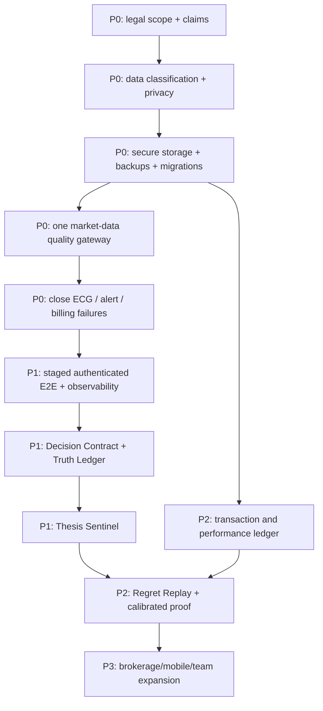

# GESH Financial — Defensible 12-Month Product Roadmap

**Roadmap start:** 2026-07-18.
**North star:** completed **decision-integrity loops**—a customer records a thesis and invalidation conditions, receives evidence-based monitoring, then performs a regret replay—rather than clicks, AI calls or raw signal wins.

## Strategic choice

Do not compete as another stock screener, generic AI analyst or auto-trading bot. Build the category **decision integrity for self-directed investors**:

> GESH helps an investor define what must be true before acting, watches whether the evidence changes, and shows how the decision process—not just the outcome—performed.

The differentiating product primitives are:

1. **Decision Contract** — asset, thesis, evidence, horizon, sizing ceiling, invalidation conditions, review date and uncertainty acknowledged before action.
2. **Truth Ledger** — immutable, source-cited observations and model versions that were actually available when the decision was made.
3. **Thesis Sentinel** — monitors contract conditions and reports evidence changes, missing data and contradictions without silently rewriting the thesis.
4. **Regret Replay** — compares the committed decision with alternatives using point-in-time information, separating bad process/good outcome from good process/bad outcome.

These features turn GESH’s existing consensus, alerts, trade contracts, proof page and audit DB into a coherent retention loop.

## Priority definitions

- **P0 — launch blocker:** legal/privacy/security/data-integrity/recovery defects that make public paid use unsafe.
- **P1 — paid-beta foundation:** trustworthy core journey, lifecycle, observability and first differentiated loop.
- **P2 — retention and evidence:** repeat use, portfolio truth and product defensibility.
- **P3 — scale and expansion:** mobile, integrations, teams and validated automation after evidence exists.

## Dependency-aware implementation order

## P0 — Weeks 0–6: make a paid beta ethically and operationally supportable

### P0.1 Legal, positioning and disclosure gate

**Deliverables**

- Securities/fintech counsel reviews the actual customer book, Kelly, deploy-cash, consensus, Congress-watch, tax and marketing flows.
- Replace draft terms; publish privacy, billing/cancellation/refund and simulated-performance disclosures.
- Remove/rename any output counsel does not approve; ban “accuracy,” “what to buy,” “safe,” and prediction claims without substantiation.
- Add versioned affirmative consent and disclosure receipts.

**Acceptance**

- Counsel sign-off and redline are retained.
- Every public/paid route maps to an approved claim/disclosure.
- Customer can retrieve the terms/privacy versions accepted.

### P0.2 Data security, rights and recovery

**Deliverables**

- Data classification and flow map for local DB/files, model vendors, Resend, Lemon Squeezy and broker/provider data.
- Private 0700 data/log directories; all sensitive files 0600; remove pickle or protect migration.
- Authenticated export/deletion request flow and retention jobs.
- Versioned SQLite migrations, encrypted off-host backups and isolated restore drill.

**Acceptance**

- Automated file-mode and secret/log-redaction tests pass.
- A fresh host restores both DBs and boots from documented commands within the recovery target.
- A test user export is complete; deletion removes or irreversibly anonymizes data per policy.

### P0.3 Financial data-quality gateway

**Deliverables**

- Central quote/history interface used by product and `gesh_core`; prohibit direct yfinance calls with a repository/static check.
- Source, observation time, cache age, adjusted/currency, suspect and coverage fields.
- Missing never becomes zero; action/sizing fails closed below coverage/freshness thresholds.
- Resolve dependency conflicts and produce a hashed lock/reproducible environment.

**Acceptance**

- Concurrent multi-symbol stress tests show no cross-symbol contamination.
- Provider outage/bad-tick/rate-limit tests yield explicit degraded states.
- `pip check` and dependency audit pass in CI.

### P0.4 Close known current-main failures

**Deliverables**

- Correct ECG history ingestion with a green PR.
- Durable alert delivery/outbox; missing-price-safe digest; POST-confirm unsubscribe; timezone-aware scheduling.
- Billing reconciliation retry, last-success ledger and alert.
- Disable/quarantine legacy paper-trade calculations; enforce or remove advertised risk controls.

**Acceptance**

- Original adversarial reproductions pass on deployed `main`.
- Synthetic provider/email/billing failures recover without duplicate/lost customer events.
- Owner health page displays intended/actual job time, coverage and last success.

## P1 — Months 2–3: launch a narrow paid beta and the first integrity loop

### P1.1 Production verification and customer lifecycle

- Create staging with synthetic customers and provider fixtures.
- Add authenticated Playwright journeys for visitor, customer A/B and owner, plus mobile-width/accessibility checks.
- Add hosted billing portal, cancellation/resume/invoice access and tested refund/access behavior.
- Implement session registry/revocation and durable rate limits.
- Add private structured logs, external availability check, job/data-quality SLOs and incident runbook.

**Exit metric:** five invited paying beta customers complete onboarding and a first research book without operator data edits; zero unresolved isolation/billing incidents.

### P1.2 Decision Contract v1

- Create an immutable/versioned contract containing thesis, evidence, disconfirming evidence, horizon, review date, maximum allocation, uncertainty, invalidation conditions and decision state.
- AI may draft fields but the user must confirm them; observed facts remain distinct from model suggestions.
- Link every deploy-cash/paper action to a confirmed contract and approved policy cap.

**Exit metric:** ≥60% of activated beta customers create a contract; ≥50% create a second contract or revise one within 30 days.

### P1.3 Truth Ledger v1

- Snapshot point-in-time prices, consensus nodes, sources, AI/model version, assumptions and data-quality envelope at contract creation/review.
- Hash/version records; corrections append rather than overwrite.
- Customer can answer “what did GESH know, from where, at that moment?”

**Exit metric:** 100% of new contracts render a reproducible evidence packet; no uncited financial facts on the contract view.

## P2 — Months 4–8: retention, portfolio truth and evidence of value

### P2.1 Thesis Sentinel

- Evaluate deterministic contract predicates first (price, earnings date, estimate revision, risk band, concentration, consensus component).
- Send evidence-change alerts with old/new source, data quality and next-review action; never silently convert to BUY/SELL.
- Customer tunes frequency/channel and sees an event/delivery history.

**Exit metric:** ≥50% monthly active contracts receive a meaningful review; false/degraded alert rate <2%; delivery success >99% excluding provider outage.

### P2.2 Regret Replay

- At contract close/review, replay hold/equal-weight/no-action/fixed-size alternatives using point-in-time ledger data.
- Grade process dimensions separately: evidence completeness, rule adherence, sizing discipline, revision timeliness and outcome luck.
- Aggregate only consented/anonymized metrics; never shame users with hindsight-only facts.

**Exit metric:** ≥40% of eligible contracts complete replay; ≥30% of those users create or improve another contract within 14 days.

### P2.3 Portfolio ledger and deterministic performance

- Add accounts, cash, immutable transactions, lots, dividends/fees/transfers, currency and corporate actions.
- Implement broker reconciliation, realized/unrealized P&L, TWR/MWR and total-return benchmarks.
- Keep research-book mode for users who do not connect accounts.

**Exit metric:** reconciled test accounts match broker statements within documented cent/share tolerances across deposits, splits, dividends and partial sales.

### P2.4 Model evaluation and proof

- Pre-register walk-forward cohorts, costs and simple baselines.
- Track calibration, drawdown, turnover, coverage and abstention by model version—not only win rate.
- Promote a model only through a shadow/display-only stage and an explicit governance decision.

**Exit metric:** a statistically defensible sample and frozen report exist; marketing remains process-led until counsel approves any performance claim.

## P3 — Months 9–12: scale only what retention proves

### P3.1 Integrations

- Read-only brokerage aggregation with least privilege, token vaulting, refresh/revocation and reconciliation.
- Data-provider licensing review before redistribution/public pages.
- Export/API for customer-owned contracts and ledgers.

### P3.2 Mobile

- Decide responsive PWA versus native Android based on beta usage.
- If native: HTTPS-only, shared auth/session lifecycle, secure storage, deep links and parity tests. Retire the current LAN prototype.

### P3.3 Teams/advisers only after legal decision

- Multi-seat organizations, role permissions, audit logs and policy templates only if counsel approves the target segment and obligations.
- Never add trade discretion/execution as a casual extension of the research product.

### P3.4 Platform hardening

- Move from single-host SQLite/launchd only when measured concurrency/recovery needs justify it.
- Containerized/reproducible service, managed database if needed, queue/outbox, zero-downtime migration and release automation.

**12-month success gate:** the cohort shows recurring integrity-loop use, not just email opens: ≥35% 90-day retained paying customers, ≥2 completed contracts/customer/month among retained users, ≥40% replay completion, <1% material data-quality incidents, and sustainable support cost.

## Pricing and packaging hypothesis

Keep one paid beta plan until the core loop is proven.

| Offer | Price hypothesis | Promise | Limits |
|---|---:|---|---|
| Founding Beta | Existing $49/month, cancel anytime | Decision Contracts, evidence ledger, sentinel reviews, research book and transparent simulated proof | Invitation-only; no live trading, tax advice or guaranteed performance; direct support and explicit beta SLA |
| Free trial | Defer | A trial can add cost/support before activation is understood. | First validate a guided demo/sample contract; then test a time- or contract-limited trial. |
| Higher tiers | Defer | Tier names without distinct entitlements create complexity, not value. | Add only after usage proves a segment needs more portfolios/contracts/team policy—not more AI tokens alone. |

## Onboarding and retention loops

**Onboarding:** choose one real decision → import/type minimal positions → see data-quality/source map → accept disclosure → draft and confirm one Decision Contract → schedule first review. Target time to value: under 10 minutes without a broker connection.

**Weekly loop:** Sentinel identifies only meaningful evidence changes → customer reviews contract → confirms, revises or closes with a reason → Truth Ledger records the state.

**Learning loop:** closed/review-date contract → Regret Replay → one concrete process improvement becomes the default for the next contract.

Avoid gamified trade frequency, urgency notifications and outcome-only leaderboards; they conflict with decision-integrity positioning.

## Work explicitly deferred

- Live order execution, options strategies and autonomous trading.
- Public Congress-trade recommendations until compliance and data-licensing review.
- ESG scores without licensed, explainable data.
- Predictive “AI accuracy” marketing.
- PostgreSQL/Redis/microservice migration without measured operational need.
- Broad mobile build before responsive web retention is proven.
