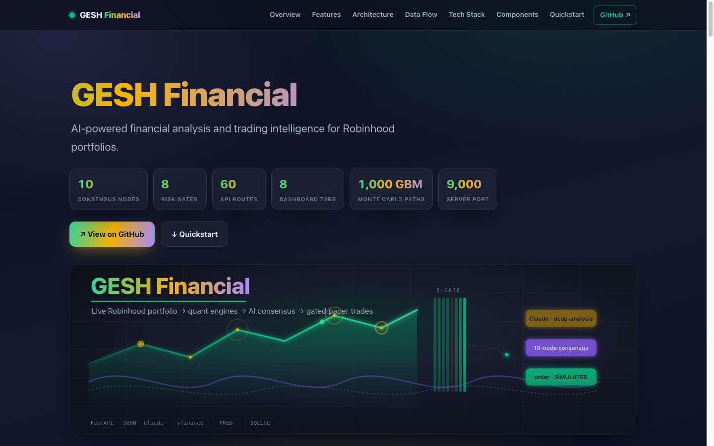
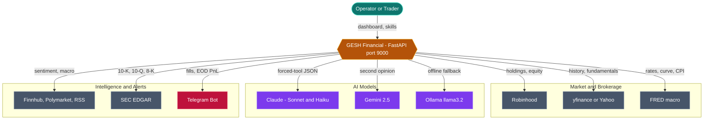
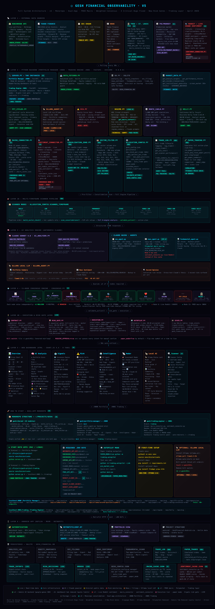

<p align="center">
  
</p>

# GESH Financial Observability Platform

## 📖 Documentation



> Open **`docs/index.html`** for the full animated single-page documentation (architecture diagrams, data flow, quickstart).


> AI-powered financial analysis and trading intelligence for Robinhood portfolios.

[](https://python.org)
[](https://fastapi.tiangolo.com)
[](https://anthropic.com)
[](LICENSE)

GESH combines live Robinhood portfolio data with Claude AI analysis engines to produce deep trading insights, EWMA/GARCH volatility models, position sizing, risk management, tax-loss harvesting, alpha benchmarking, crypto-equity correlation analysis, AI transparency/explainability, DeFi yield optimization, and a full signal → gate → execution pipeline.

---

## 🏛️ Architecture

GESH ingests a live Robinhood portfolio, runs it through quantitative engines and a 10-node consensus voting engine, routes structured prompts to Claude/Gemini/Ollama, then passes every signal through an 8-gate risk gate before a paper-mode execution layer simulates orders. The diagram below is the system-context view — **[see `docs/ARCHITECTURE.md`](docs/ARCHITECTURE.md)** for the full set of container, sequence, data-flow, consensus, autopilot, and persistence diagrams.



---

## Architecture Diagram



> Full interactive version (with animations): open `Gesh_Architecture_Diagram.html` locally in your browser.

---

## Features

| Category | Capability |
|---|---|
| **Portfolio Analysis** | Live holdings, equity snapshots, P&L tracking via Robinhood |
| **AI Engines** | Claude Sonnet (deep analysis), Gemini 2.5 Flash/Pro (batch sentiment + second opinion), Llama 3.2 (local fallback) |
| **Market Regime** | ADX + Bollinger + RSI + FRED macro layer (Fed funds, yield curve, CPI) |
| **Consensus Engine** | 10-node voting system (momentum, trend, fundamentals, analyst, news, Kelly, ECG, volume, FFT) |
| **Risk Management** | 8-gate risk gate, Kelly Criterion sizing, Monte Carlo stress tests (1000 GBM simulations) |
| **Volatility Models** ✨ | **EWMA** (RiskMetrics λ≈0.94) + **GARCH(1,1)** — recent shock weighting, volatility clustering detection |
| **Tax-Loss Harvesting** ✨ | IRS wash-sale window tracking (30 days), min $500 threshold, eligible loss scanner |
| **Alpha Benchmarking** ✨ | Per-holding alpha vs SPY + sector ETF (A–F grade) across 30+ ticker→ETF mappings |
| **Crypto Correlation** ✨ | Rolling 90-day BTC/ETH correlation per holding — correlated drawdown risk detection |
| **AI Transparency** ✨ | Plain-English per-node narrative, conflict detection, confidence bar per symbol |
| **DeFi Yield Optimization** ✨ | 3-tier cash yield comparison: T-bills → bond ETFs → DeFi stablecoins (informational) |
| **API Security Layer** ✨ | NaN/Inf sanitisation, rate-limit guard, price anomaly detection, secret masking |
| **News Sentiment** | Yahoo Finance RSS + Finnhub + Polymarket macro prediction market signals |
| **SEC Watcher** | EDGAR filing alerts for 10-K, 10-Q, 8-K |
| **FFT Cycles** | Dominant price cycle detection via Fast Fourier Transform |
| **Scanner Pipeline** | Sector pre-filter → consolidation zone detection → full engine analysis |
| **Paper Trading** | Full simulated execution with win-rate tracking, no real money at risk |
| **Trading Autopilot** | Scheduled scan / execute / rebalance / EOD jobs via APScheduler |
| **Telegram Alerts** | Fill notifications, rejections, EOD P&L summaries |
| **Web Dashboard** | React-style Chart.js UI with 8 tabs (incl. Daily Analysis), served at port 9000 |

---

## Architecture

```
server.py (FastAPI · Port 9000)
│
├── SIGNAL & ANALYSIS LAYER
│   ├── auth.py              — Robinhood login/logout (MFA-aware)
│   ├── data_fetcher.py      — Live portfolio: holdings, equity, watchlist quotes
│   ├── ai_analyzer.py       — Claude AI prompts + structured schemas (3 analyzers)
│   ├── market_data.py       — Market screening universe + analyst targets
│   ├── fundamental_agent.py — Fundamental momentum scanner (80+ stocks, yfinance)
│   ├── news_agent.py        — News sentiment (Yahoo RSS + Finnhub + Polymarket macro)
│   ├── sec_agent.py         — SEC EDGAR filing watcher (10-K, 10-Q, 8-K)
│   ├── regime.py            — Market regime + FRED macro (Fed rate, yield curve, CPI)
│   ├── monte_carlo.py       — EWMA vol + regime-conditional drift, 1000 GBM paths ✨
│   ├── kelly.py             — Kelly Criterion position sizer
│   ├── consensus.py         — 10-node consensus voting engine
│   ├── ecg.py               — Equity Curve Gate (drawdown circuit breaker)
│   ├── fft_cycles.py        — FFT dominant price cycle detection
│   ├── ollama_agent.py      — Local LLM second opinion (Ollama / llama3.2:3b)
│   ├── gemini_agent.py      — Google Gemini 2.5 Flash + Pro
│   └── db.py                — SQLite persistence (gesh_financial.db)
│
├── SPRINT 3 — ADVANCED ANALYTICS ✨
│   ├── volatility_models.py  — EWMA (RiskMetrics) + GARCH(1,1) volatility comparison
│   ├── tax_harvester.py      — IRS wash-sale scanner, $500 min threshold, SQLite log
│   ├── benchmarks.py         — Alpha vs SPY + 30 sector ETFs, A–F grade
│   ├── crypto_correlation.py — Rolling 90-day BTC/ETH correlation per holding
│   ├── explainability.py     — Plain-English consensus narrative + conflict detection
│   ├── defi_yield.py         — 3-tier cash yield (T-bills → bond ETFs → DeFi)
│   └── security/
│       └── api_verifier.py   — NaN/Inf sanitiser, rate-limit guard, anomaly detector
│
├── TRADING PIPELINE LAYER
│   ├── consolidation_zone.py — 10+ candle tight range detector
│   ├── sector_filter.py      — ETF sector volume pre-filter (1.2× 20-day avg)
│   ├── allocation_config.py  — Config manager (gesh_config.json)
│   ├── trade_log.py          — Full trade lifecycle logging + win-rate tracking
│   └── paper_trading.py      — Paper trade simulation
│
└── EXECUTION TIER (trading/ subpackage)
    ├── trading/config.py     — RiskConfig dataclass (env-var driven)
    ├── trading/contract.py   — TradeIntent dataclass + adapters
    ├── trading/state.py      — trade_intents / risk_decisions / orders SQLite tables
    ├── trading/risk_gate.py  — 8-gate risk gate
    ├── trading/execution.py  — Paper/live broker wrapper with idempotency
    ├── trading/alerts.py     — Telegram alerts
    └── trading/autopilot.py  — APScheduler: 08:30 / 09:35 / 12:30 / 15:55 ET
```

---

## Quick Start

### Prerequisites

- Python 3.14+
- Robinhood account
- Anthropic API key

### Setup

```bash
git clone https://github.com/gesh75/gesh-project.git
cd gesh-project
python -m venv venv
source venv/bin/activate
pip install -r requirements.txt   # or install manually — see Dependencies
```

### Environment variables

Create a `.env` file in the project root:

```env
# Required
ANTHROPIC_API_KEY=sk-ant-...

# Optional — enhances capabilities
FINNHUB_API_KEY=...         # Richer news sentiment
GEMINI_API_KEY=...          # Google Gemini 2.5 Flash/Pro
CLAUDE_MODEL=sonnet         # "sonnet" (default) or "haiku"

# Trading execution — defaults are safe, change only after paper testing
PAPER_MODE=true
REQUIRE_APPROVAL=true
KILL_SWITCH_PATH=~/.gesh/KILL
MAX_POSITION_PCT=0.02
MAX_DAILY_LOSS_PCT=0.01
MAX_ORDERS_PER_DAY=3
MIN_CASH_BUFFER_USD=500
MIN_CONFIDENCE=0.75
MAX_PRICE_AGE_SECONDS=300

# Telegram alerts (optional)
TELEGRAM_BOT_TOKEN=...
TELEGRAM_CHAT_ID=...
TELEGRAM_ALERTS=true
```

### Run

```bash
# Start the web server (port 9000)
python server.py

# CLI quick analysis
python main.py

# Run autopilot (paper mode)
PAPER_MODE=true python -m trading.autopilot

# Run a single autopilot job
python -m trading.autopilot --job pre_market_scan
```

Open **http://localhost:9000** for the dashboard.

---

## AI Models

| Model | Provider | Role |
|---|---|---|
| `claude-sonnet-4-6` | Anthropic | Deep portfolio analysis, screener, SEC, fundamentals |
| `claude-haiku-4-5-20251001` | Anthropic | Batch news sentiment (fast + cheap) |

**Routing rule:** High-volume/batch tasks → Haiku. Complex reasoning and deep analysis → Sonnet.

---

## Consensus Engine — 10 Nodes

| Node | Signal Source |
|---|---|
| MOMENTUM | RSI + 20/50 MA crossover (90-day daily) |
| TREND | ADX + Bollinger regime |
| RELATIVE_STR | Performance vs SPY |
| FUNDAMENTALS | Revenue growth + margins + P/E |
| ANALYST | Wall St consensus + target upside |
| NEWS | Cached sentiment score |
| KELLY | Position sizing signal |
| ECG | Equity Curve Gate health |
| VOLUME | Volume trend + liquidity |
| FFT_CYCLE | Dominant price cycle phase |

**Voting:** BULLISH = +1, NEUTRAL = 0, BEARISH = −1, ABSTAIN = None  
**Signal threshold:** ≥5 nodes + score ≥0.55 → STRONG BUY/SELL; ≥0.25 → BUY/SELL

---

## Risk Gate — 8 Gates (in priority order)

1. **KILL_SWITCH** — file at `~/.gesh/KILL` → reject all orders immediately
2. **MARKET_HOURS** — outside 09:30–16:00 ET → reject
3. **CONFIDENCE_FLOOR** — intent confidence < `MIN_CONFIDENCE` → reject
4. **POSITION_CAP** — target position > `MAX_POSITION_PCT` of equity → reject
5. **ORDER_RATE** — orders today ≥ `MAX_ORDERS_PER_DAY` → reject
6. **CASH_FLOOR** — post-trade cash < `MIN_CASH_BUFFER_USD` → reject
7. **DAILY_LOSS** — portfolio P&L ≤ −`MAX_DAILY_LOSS_PCT` → reject all
8. **DATA_FRESH** — last quote > `MAX_PRICE_AGE_SECONDS` old → reject

Every gate decision (approve or reject) is persisted to `risk_decisions` before returning.

---

## Scanner Pipeline

For 5MIN and 1HR modes, always run in this order:

```python
from sector_filter import batch_sector_check
from consolidation_zone import scan_consolidations

# Step 1 — cheap sector pre-filter (one ETF fetch per sector)
sector_report = batch_sector_check(candidate_symbols)
hot_symbols = [r["symbol"] for r in sector_report["hot"]]

# Step 2 — consolidation zone scan (pure price math)
cz_report = scan_consolidations(hot_symbols, interval="5m", period="1d", min_rr=2.0)

# Step 3 — full engines only on symbols with valid zone + hot sector
zone_symbols = [r["symbol"] for r in cz_report["found"]]
```

**Consolidation zone trade levels:**

| Field | Value |
|---|---|
| Entry | Zone midpoint |
| Stop | Zone low − 0.5% |
| Target | Previous zone high (or entry + 2× risk) |
| Min R/R | 2.0× (setups below this filtered out) |

---

## Scanner Timeframe Modes

| Mode | Period | Interval | Use case |
|---|---|---|---|
| `daily` | 60d | 1d | Key levels + sweep setups (default) |
| `1HR` | 5d | 1h | Multi-timeframe intraday swings |
| `5MIN` | 1d | 5m | High-frequency momentum |
| `premarket` | 1d | 5m | Unusual volume + gap moves |
| `stock` | 30d | 1d | Penny stocks $0.50–$10 |
| `forex-1HR` | 5d | 1h | Forex majors/minors/metals |
| `forex-4HR` | 10d | 4h | Higher TF forex setups |
| `forex-daily` | 60d | 1d | Daily forex trends |

---

## Autopilot Schedule

| Time (ET) | Job | Description |
|---|---|---|
| 08:30 | `pre_market_scan` | Consensus over watchlist, store BUY/SELL candidates |
| 09:35 | `open_window` | Execute candidates through risk gate (paper mode) |
| 12:30 | `midday_rebalance` | Re-run consensus on held positions, check >5% drift |
| 15:55 | `close_risk_check` | EOD stop-loss sweep + P&L Telegram alert |

---

## API Endpoints

### Core Analysis

| Endpoint | Method | Description |
|---|---|---|
| `/` | GET | Dashboard HTML |
| `/api/portfolio` | GET | Live portfolio + equity summary |
| `/api/analyze` | POST | Quick AI risk analysis |
| `/api/deep-analysis` | POST | Full deep analysis with regime injection |
| `/api/screener` | POST | AI stock screener (top 10 from 95+ stocks) |
| `/api/regime` | GET | Market regime detection (ADX/BB/RSI + FRED macro) |
| `/api/kelly` | POST | Kelly position sizing |
| `/api/monte-carlo` | POST | Portfolio stress test |
| `/api/consensus` | POST | 10-node consensus engine |
| `/api/ecg` | GET | Equity Curve Gate status |
| `/api/fft-cycles` | GET | FFT cycle detection (all holdings) |
| `/api/fft-cycles/{symbol}` | GET | FFT for single symbol |
| `/api/chart/{symbol}` | GET | Price chart data |
| `/api/market-data` | GET | Analyst targets + insider + institutional |

### Intelligence Agents

| Endpoint | Method | Description |
|---|---|---|
| `/api/agents/sec` | POST | Watch SEC EDGAR filings |
| `/api/agents/news` | POST | Scan news sentiment |
| `/api/agents/fundamentals` | POST | Run full fundamental scan |

### Trading Pipeline

| Endpoint | Method | Description |
|---|---|---|
| `/api/trades` | GET | Trade history (`?paper=true` for paper trades) |
| `/api/trades/stats` | GET | Win rate + P&L + scanner performance |
| `/api/paper/run` | POST | Simulate action plan in paper mode |
| `/api/paper/summary` | GET | Paper vs live performance summary |
| `/api/trading/dry-run` | POST | Gate-check an intent without executing |
| `/api/trading/paper-order` | POST | Gate + paper execute |
| `/api/trading/consensus-order` | POST | Full signal → gate → paper pipeline |

### Config & Scanner

| Endpoint | Method | Description |
|---|---|---|
| `/api/config` | GET / POST | Get or update allocation config |
| `/api/scanner/consolidation` | POST | Batch consolidation zone scan |
| `/api/scanner/sector` | POST | Batch sector pre-filter |

### Sprint 3 — New Endpoints ✨

| Endpoint | Method | Description |
|---|---|---|
| `/api/volatility/compare/{symbol}` | GET | EWMA vs GARCH(1,1) annual vol%, preferred model, diff in basis points |
| `/api/tax/harvest` | GET | Tax-loss harvesting candidates with wash-sale status |
| `/api/benchmarks/{period}` | GET | Alpha table: each holding vs SPY + sector ETF, A–F grade |
| `/api/crypto-correlation` | GET | BTC/ETH rolling 90-day correlation per holding, risk label |
| `/api/explainability/{symbol}` | GET | Plain-English consensus narrative, per-node bullets, conflict notes |
| `/api/yield/landscape` | GET | 3-tier cash yield comparison with monthly income projection |
| `/api/security/health` | GET | API source health — rate-limit stats, last errors |

---

## Database

**`gesh_financial.db`** (SQLite)

| Table | Contents |
|---|---|
| `analysis_log` | Deep AI analysis runs (JSON results, model, timestamps) |
| `equity_snapshots` | Per-symbol equity per refresh — used by ECG |
| `news_sentiment` | Per-symbol sentiment scores (−100 → +100) |
| `sec_filings` | Analyzed SEC filing results |
| `fundamental_scans` | Weekly fundamental scan results |
| `trade_log` | Real executed trades with P&L and outcome |
| `paper_trades` | Simulated trades (same schema) |
| `trade_intents` | Every TradeIntent produced by any signal engine |
| `risk_decisions` | Every gate verdict with per-gate breakdown |
| `orders` | Every simulated or real broker submission |

> **VirtioFS note:** If `gesh_financial.db` is on a macOS-shared FUSE mount, `trade_log.py` auto-detects this and falls back to `/tmp/gesh_trades.db` for trading tables.

---

## Warning Thresholds

| Metric | Threshold |
|---|---|
| VaR 95% | > 15% of portfolio → RED |
| Sector concentration | > 40% single sector → WARNING |
| Portfolio beta | > 1.5 → amplified drawdown warning |
| Cash | < 5% → no dry powder warning |
| Kelly total allocated | > 100% → over-conviction warning |
| Sentiment swing | > 30 pts vs 7-day rolling → ALERT |
| Daily P&L | ≤ −1% → risk gate blocks all orders |

---

## Dependencies

```bash
pip install robin_stocks anthropic fastapi uvicorn yfinance pandas numpy \
            requests apscheduler python-dotenv google-genai \
            --break-system-packages
```

---

## Infrastructure (macOS Auto-Start)

| Service | Port | Log |
|---|---|---|
| gesh-project | 9000 | `/tmp/gesh_main.log` |

```bash
# Restart the LaunchAgent
launchctl bootout gui/$(id -u)/com.gesh.main
launchctl bootstrap gui/$(id -u) ~/Library/LaunchAgents/com.gesh.main.plist
```

---

## Disclaimer

This tool is for informational and educational purposes only. Nothing here constitutes financial advice. All trading decisions are the user's sole responsibility.

**`PAPER_MODE=true` by default.** Never switch to live execution without weeks of clean paper trading history and a thorough review of the risk gate configuration.

---

*Built by Georgi Gaydarov — Network Engineering Leader & AI Tools Builder.*
