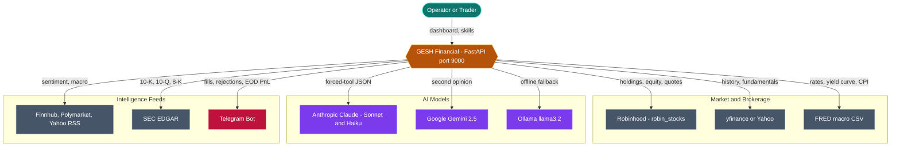
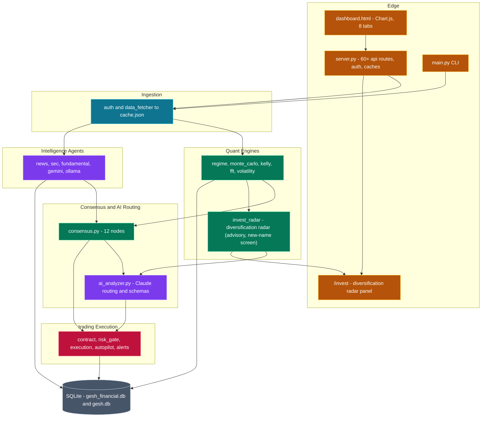
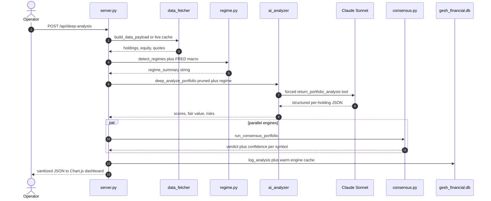
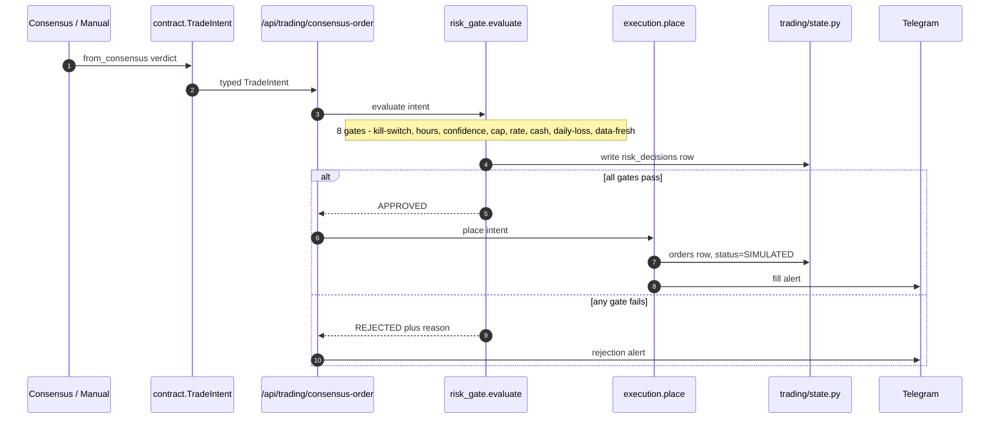
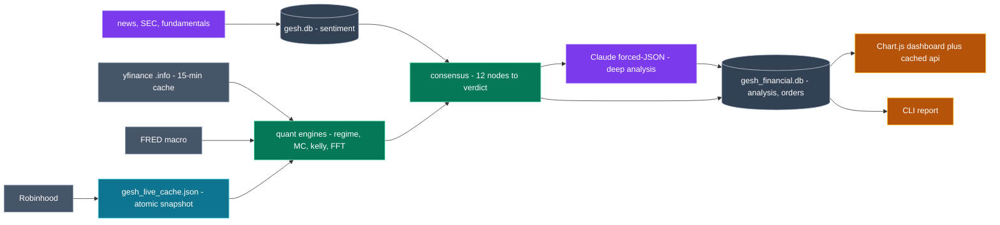
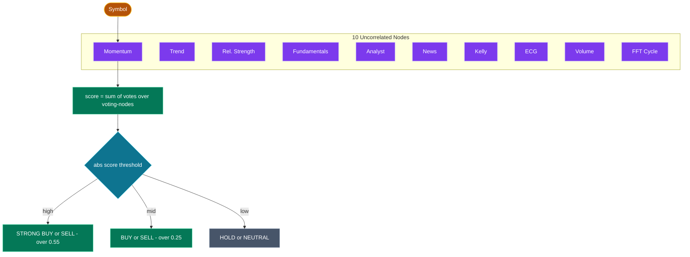
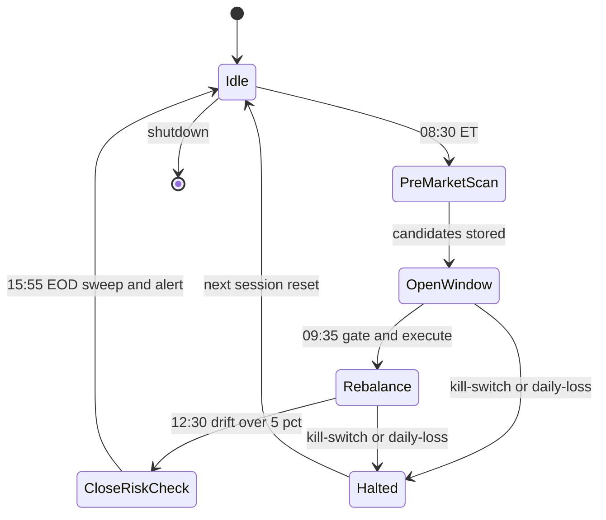
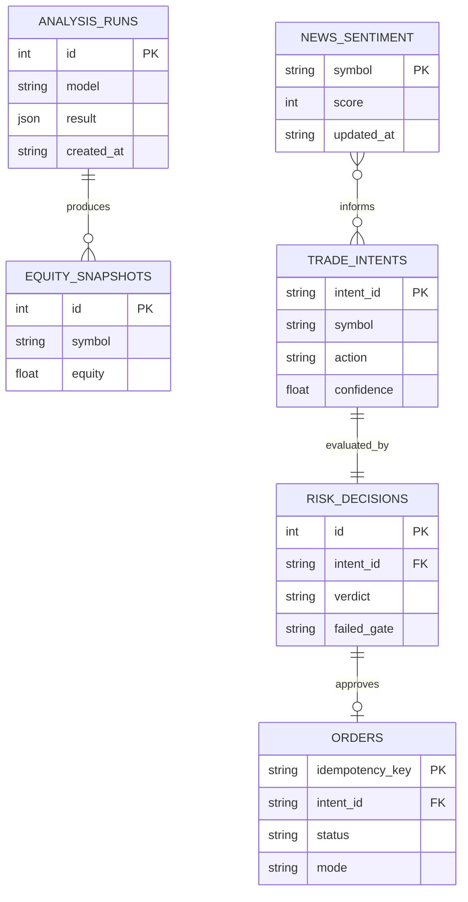

  

# 🏛️ GESH Financial — Architecture

GESH Financial is a single-node Python platform that turns a **live Robinhood portfolio** into AI-driven trading intelligence. A FastAPI server (port `9000`) ingests holdings via `robin_stocks`, runs a stack of quantitative engines (ADX/Bollinger/RSI **regime** with a live FRED macro layer, **Monte Carlo**, **Kelly** sizing, **FFT cycles**, EWMA/GARCH volatility) and a **12-node consensus** voting engine, then routes structured prompts to Claude (Sonnet/Haiku), Gemini, and a local Ollama model for deep analysis and contrarian second opinions. Every signal is funneled through a typed **`TradeIntent`** contract and an **8-gate risk gate** before a paper-mode execution layer simulates orders — with the whole `signal → gate → execute` chain audited to SQLite and scheduled by an APScheduler autopilot. The Chart.js dashboard is the customer-facing product; the trading engine runs silently to accumulate paper win-rate proof.

On top of the owner engine sits a **per-user customer surface** (the *Analyze* tab): any-ticker research cards (company-name→ticker search, 12-node consensus, momentum RSI/MACD/Volume, support/resistance trade setup, EPS beat/miss earnings, regime, cycle, fundamentals, analyst, news), a price-grounded **AI research card** (one Claude call/symbol/15 min), a per-user **watchlist + portfolio book**, and a full engine run on the customer's own book — all money-masked so a customer never sees the owner's real account dollars. Customer HTTP also runs inside `unauthenticated_rh_fallback()` so a Yahoo 401 cannot restore the owner's `robin_stocks` pickle (PR #258). See [`CUSTOMER_SURFACE.md`](CUSTOMER_SURFACE.md).

---

## Table of Contents

1. [System Context](#1-system-context)
2. [Container & Component Map](#2-container--component-map)
3. [Primary Flow — Deep Analysis (sequence)](#3-primary-flow--deep-analysis-sequence)
4. [Signal → Gate → Execute Pipeline (sequence)](#4-signal--gate--execute-pipeline-sequence)
5. [Data Flow](#5-data-flow)
6. [12-Node Consensus Engine (flow)](#6-12-node-consensus-engine-flow)
7. [Autopilot Trading Day (state)](#7-autopilot-trading-day-state)
8. [Persistence Model (ER)](#8-persistence-model-er)
9. [Tech Stack](#9-tech-stack)

---

## 1. System Context

The platform sits between a single **operator/trader** and a fan of external market, intelligence, and AI APIs — pulling live portfolio + market data in, and pushing structured analysis to a dashboard and Telegram alerts out.

---

## 2. Container & Component Map

Inside the single `server.py` process, work is layered: **ingestion** feeds **quant engines** and **intelligence agents**, which feed the **consensus + AI routing** layer, which hands verdicts to the **trading execution** subpackage — all backed by **dual SQLite stores**.

---

## 3. Primary Flow — Deep Analysis (sequence)

A deep-analysis request fans out across ingestion, regime detection, Claude forced-tool JSON, and the parallel consensus/Kelly/Monte-Carlo engines, then persists the run and returns sanitized JSON the dashboard renders.

---

## 4. Signal → Gate → Execute Pipeline (sequence)

A chosen verdict becomes a typed `TradeIntent`, runs through the eight ordered risk gates (each persisted), and on approval writes a SIMULATED paper order with an idempotency key — optionally firing a Telegram alert.

---

## 5. Data Flow

Live brokerage and market data converge with external intelligence, feed the quant + consensus engines and Claude, then split into a persisted audit trail and a rendered result surface.

---

## 6. 12-Node Consensus Engine (flow)

Ten intentionally-uncorrelated signal nodes each vote BULLISH/NEUTRAL/BEARISH/ABSTAIN; the normalized score is thresholded into STRONG/BUY/SELL or HOLD verdicts.

---

## 7. Autopilot Trading Day (state)

The APScheduler autopilot replays the `scan → execute → rebalance → EOD` pipeline on an Eastern-Time cron, looping each weekday and pushing a Telegram P&L summary at close.

---

## 8. Persistence Model (ER)

The audit chain links every signal to its gate verdict and resulting simulated order across the `gesh_financial.db` analysis and trading tables.

---

## 9. Tech Stack

| Layer | Technologies |
|---|---|
| **API / Server** | FastAPI · uvicorn · threading · hmac (X-API-Key) |
| **Ingestion** | robin_stocks · pyotp · pandas · atomic JSON cache |
| **Quant Engines** | numpy · pandas · yfinance · FRED CSV API |
| **AI Routing** | Anthropic Claude (Sonnet/Haiku) · forced tool-use · prompt caching |
| **Alt Intelligence** | Google Gemini 2.5 · Ollama llama3.2 · Finnhub · Polymarket · SEC EDGAR · VADER |
| **Execution** | dataclasses · APScheduler · zoneinfo · SHA1 idempotency · Telegram Bot API |
| **Persistence** | sqlite3 — `gesh_financial.db` · `gesh.db` |
| **Presentation** | Chart.js dashboard (8 tabs) · `.claude/skills/*` playbooks · ANSI CLI |
| **Runtime** | Python 3.12+ · macOS launchd auto-start |

---

Generated architecture documentation · diagrams render natively on GitHub.

