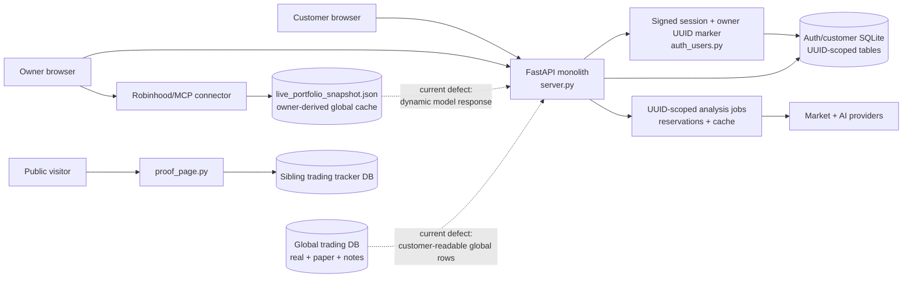
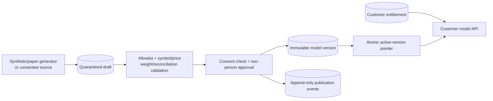

# GESH 02 — Architecture and Data Flow

**Code anchors:** checked branch `09f757c3` unless a ref is stated explicitly  
**Live evidence:** 2026-07-25  
**Architecture decision:** separate customer, model-publication, owner, and public-proof domains

## Canonical architecture in one view



The dashed paths are the two P0 data-product boundary failures. They are authenticated paths, but authentication alone does not make their data appropriate for a customer.

## Domain model that actually exists

### 1. Customer identity and customer-owned data

**VERIFIED CURRENT**

- A signed, expiring, purpose-bound session carries an immutable user UUID (`auth_users.py:124-190`).
- Global login middleware protects non-public surfaces (`server.py:459`; `auth_users.py:1487`).
- Owner status is resolved through a durable UUID marker in `auth_metadata`, not a query parameter or email string (`auth_users.py:1410-1431`).
- The following tables are keyed to the authenticated UUID (`auth_users.py:204-301`):
  - `customer_positions`;
  - `watchlist`;
  - `customer_analyses`;
  - `usage_events`;
  - `customer_book_prefs`;
  - `mybook_jobs`;
  - `usage_reservations`.
- Their normal queries include the user UUID (`auth_users.py:1560-1701`, `1742-1779`, `1881-2037`).

This is real tenant isolation. Harmless `user`, `user_id`, `account`, `account_id`, `view`, `role`, and owner-like inputs did not switch the live caller or modify another object.

### 2. `view=model_book`

**VERIFIED CODE; VERIFIED CURRENT response**

`view=model_book` is not a persisted assignment to a model portfolio. `/api/me` determines customer versus owner, and customer response middleware stamps `view=model_book` onto non-owner JSON (`server.py:781-810`; `/api/me` at `server.py:899-909`).

The present selection logic is effectively:

```text
valid signed session
→ resolve immutable subject UUID
→ subject equals durable owner UUID?
   → yes: owner behavior
   → no: customer response convention "view=model_book"
```

No reviewed user schema contains:

- `model_portfolio_id`;
- `model_portfolio_version_id`;
- a durable `view` assignment;
- an entitlement;
- a publication approval;
- a consent reference.

The label therefore describes a presentation convention, not a data relationship.

### 3. My Book

**VERIFIED CURRENT**

My Book is the customer’s private, UUID-scoped position ledger. It is not the shared Model Book.

`/api/mybook`:

```text
session subject UUID
→ customer_positions WHERE user_id = subject
→ public market quote / previous-close data
→ Decimal valuation
→ caller's private response
```

Relevant code is in `server.py:3505-3712`, with persistence in `auth_users.py`. The live customer had one TSLA row. Its quantity, export, valuation, prior-close value, and day change agreed and reconciled independently.

Cost basis is optional and currently absent for the baseline position, so unrealized P&L is correctly unavailable rather than fabricated.

### 4. Model Book / `/api/portfolio`

**OPEN P0 in live and `origin/main`; PARTIALLY FIXED in candidate branches**

This route does not read `customer_positions`.

Current/legacy path:

```text
owner Robinhood connector OR global owner snapshot file
→ normalize real account payload
→ scale/mask/label as model_book
→ authenticated customer /api/portfolio
```

Checked-branch anchors:

- handler and source selection: `server.py:2147-2216`;
- data fetch/cache path: `data_fetcher.py:43-140`, `300-313`;
- raw snapshot construction: `build_snapshot_from_mcp.py:40-56`, `80-142`;
- candidate serializer: `model_portfolio.py:22-30`.

`origin/main:server.py:1776-1822` directly builds the live/global owner object and relies on customer response transformation. The live response still exposes `source=robinhood_mcp`, proving that the production path is not the safe end-state claimed by later branch documentation.

The checked branch and PR #105 call a `model_portfolio.publish()`-style allowlist. That is a useful serializer boundary, but not a publication system:

- it derives content at request time from the current owner snapshot;
- changing the owner snapshot can change the customer result without an approval event;
- `published_at` is not a durable publication event;
- there is no immutable version or byte-stable artifact;
- there is no consent artifact;
- there is no approver/editor;
- there is no assignment or entitlement;
- there is no atomic rollback pointer;
- it still publishes owner-derived composition, prices, proportional quantities, cash allocation, and day change.

Removing the text `robinhood_mcp` or stripping account IDs changes serialization. It does not change provenance.

### 5. Trades

**OPEN P0**

`/api/trades` and `/api/trades/stats` do not query a customer-owned trade domain:

```text
authenticated request
→ global trade_log / paper_trades tables
→ SELECT *
→ row dicts, including free-text notes
→ customer response
```

Anchors:

- unguarded read handlers: `server.py:4847-4864`;
- global schemas: `trade_log.py:26-97`;
- row serialization: `trade_log.py:233-267`;
- aggregate path: `trade_log.py:383-397`.

The global tables have no `user_id`, `tenant_id`, publication status, consent field, public schema version, or model-version key. Both real and paper tables contain `notes`. `/api/trades/stats` accepts a paper-like parameter but its aggregation returns both classes.

The broad customer masker is not a safe control for this domain. It targets selected strings/numbers and does not reject arbitrary operational text. PR #105’s tests explicitly expect these paths to return 200 to customers and inspect only monetary sentinel behavior (`tests/test_customer_leak_sweep.py:131-141`, `246-247`, `339-353`, `386-411`).

### 6. `robinhood_mcp`

**VERIFIED PROVENANCE**

`robinhood_mcp` is a provider/source marker for an operator-connected real brokerage snapshot. It is not a customer tenant, not a model publication, and not a synthetic ledger.

The snapshot builder can persist:

- real holding symbols and quantities;
- prices and average purchase prices;
- cash, buying power, withdrawable/margin-like fields;
- provider/session metadata;
- account-level totals.

It belongs in the owner/internal trust domain. A customer-serving handler must not depend on this connector or fall back to this cache.

### 7. Export

**FIXED AND VERIFIED live**

`/api/account/export` follows:

```text
session UUID
→ account row + positions + preferences + watchlist + analyses + usage
→ caller-only export
```

The export assembly is in `auth_users.py:2128-2186`. The historical `2.7971` discrepancy did not come from a second position store. A broad response transformation scaled the export after correct UUID-scoped retrieval. Exempting account export and centralizing quantity semantics repaired the live mismatch.

There is no corresponding full account-import/restore endpoint, so “round trip” currently means write/read/export parity, not a proven export-to-restore workflow.

### 8. My Book analysis

**PARTIALLY FIXED**

```text
authenticated UUID
→ syntax normalization
→ quota reservation + durable job row
→ bounded in-process executor
→ price/research/AI providers
→ result/cache associated with UUID
→ 202 polling contract
```

Anchors:

- symbol syntax guard: `server.py:212-221`;
- route/job orchestration: `server.py:3736-3770`, `3972-4110`;
- reservations/jobs: `auth_users.py:1931-2025`.

Strengths:

- UUID-scoped durable jobs and reservations;
- single-flight/unique-active protections;
- quota release and cached results;
- fresh live run completed, and the next call was cached.

Gap:

- `_safe_symbol` proves syntax, not listed-asset existence;
- some My Book paths can persist or queue a syntactically valid unknown before the worker discovers no market data;
- late failure consumes job latency and complicates customer messaging, even if quota is later released.

External news/research content and model output are untrusted data. They must remain data fields in structured prompts and must never control provider/tool selection, URLs, system instructions, or HTML rendering.

### 9. Charts

**FIXED backend; PARTIALLY FIXED product**

Checked code validates period/range, supports `max`, and caches briefly (`server.py:2574-2673`). Fresh live tests proved materially distinct 1D, 5D, 1M, 3M, 6M, 1Y, and max datasets.

The rendered UI has no ALL/MAX control (`templates/owner_console.html:94-99`; `templates/dashboard.html` around the range controls). Intraday responses also lack a populated source label, unlike longer Yahoo-backed periods.

### 10. Preferences and watchlist

**VERIFIED CURRENT**

Both are resolved entirely from the signed-session UUID. Query/body identity fields do not select a different user. Controlled add/update/delete tests restored the exact baseline.

### 11. Track record

**PARTIALLY FIXED**

The public proof surface is separate from customer My Book and the model portfolio:

```text
public visitor
→ proof_page.py
→ sibling trading tracker DB
→ engine/manual/blended cohort aggregation
→ readiness/gate DTO + benchmark formatting
```

Anchors:

- page/aggregation: `proof_page.py:41-55`, `93-157`, `176-293`;
- engine-first presentation on candidate branches: `proof_page.py:370-461`;
- sibling gate/tracker contract: `trading/tracker.py:829-861`.

The architecture now distinguishes engine, manual, and blended cohorts more clearly. The calculation contract still mixes:

- headline “total P&L”: sum of row-level `pnl_pct`;
- profit factor: dollar `pnl_usd` gains divided by losses;
- benchmark: a separate price-period result that can be non-finite.

These measures may legitimately have different signs, but the page does not make the bases explicit and calls the unweighted sum a product-level total return. Overlapping trades and different position sizes make that label materially misleading.

## Browser/runtime architecture finding

**VERIFIED CURRENT**

Visible owner controls were removed from the normal customer page, but shared JavaScript still initializes owner-oriented data flows:

- `loadPortfolioWithECG()` runs on initialization and repeats on the refresh interval;
- it fetches `/api/portfolio`;
- owner-only DOM nodes are absent;
- render functions dereference `null`, causing ECG, stats, and regime errors;
- at least the stats failure repeats every 30 seconds.

The customer page therefore still receives and processes owner/model data even when the cards are cosmetically hidden. This is both proof of incomplete UI separation and an unnecessary P0 data fetch.

The port-9000 process started on 2026-07-23 at 06:29, while key source/template files changed later. Uvicorn reload is disabled. Static/runtime-read files and in-memory imported Python may therefore represent different revisions. No build endpoint resolves the ambiguity.

## Trust-boundary analysis

| Domain | Intended classification | Current storage/source | Allowed consumers | Current failure |
|---|---|---|---|---|
| Customer identity/session | Confidential auth data | auth DB, signed cookie | Auth middleware/account owner | No current bypass reproduced |
| My Book | Customer private financial data | UUID-scoped `customer_positions` | Same customer; support only under explicit policy | Healthy core boundary; missing cost basis and universal asset preflight |
| Customer watchlist/preferences/jobs | Customer private/product data | UUID-scoped tables | Same customer | Healthy core boundary |
| Model Book publication | Customer-visible licensed product data | No durable model tables; dynamic owner snapshot projection | Entitled customers | No consent/version/approval/assignment; P0 provenance |
| Owner brokerage snapshot | Highly confidential operator financial data | connector + global snapshot file | Owner/internal jobs only | Dynamically feeds customer model route |
| Real trade ledger/notes | Highly confidential operator strategy/execution data | global trade DB | Owner/internal only | Customer route serializes it |
| Paper/synthetic model events | Customer-visible only after publication | Mixed into global trade infrastructure | Entitled customers | No curated public schema |
| AI/provider inputs | Third-party/untrusted data | caches/provider responses | Analysis pipeline | Needs strict structured boundary/provenance |
| Public track record | Public marketing/proof data | sibling tracker DB | Anyone | Metric bases/benchmark presentation not contract-safe |
| Deployment identity | Operational control | launchd process + filesystem | Operators/auditors | No SHA/schema/build identity |

## Why this is not merely an authorization bug

The architecture must distinguish:

1. **Authentication:** is there a valid session? Mostly sound in tested paths.
2. **Route authorization:** may this role invoke the handler? Mostly sound for owner routes; intentionally permissive for the two P0 handlers.
3. **Object authorization:** is the selected row/object owned or entitled? Sound for UUID customer tables; absent for global model/trade data.
4. **Data provenance:** where did the information originate? Real operator brokerage/trade records.
5. **Sanitization:** which fields may be published? Incomplete and historically broad/transformational.
6. **Consent and policy:** is that source allowed to become customer content? No durable evidence found.
7. **Publication:** was an exact reviewed artifact approved, versioned, and assigned? No.

A 200 response can be “authorized by current code” and still violate privacy, product, and compliance boundaries.

## Remediation options A–E

| Option | Result | Use |
|---|---|---|
| **A. Scope `/api/portfolio` and `/api/trades` to the authenticated customer’s records** | Safe for My Book; no customer-owned trade domain exists. Removes the shared-model experience if used alone. | Valid if `/api/portfolio` is deliberately redefined as a My Book alias. |
| **B. Remove customer access and return 403/404** | Immediately stops exposure; no migration required. | **Required containment now** for portfolio, trades, and stats until safe replacements exist. |
| **C. Separate curated model tenant/dataset** | Creates authorization, provenance, reconciliation, versioning, entitlement, and auditability. | **Recommended durable target.** |
| **D. Synthetic/paper model** | No real brokerage provenance; simplest consent and privacy story. | **Recommended default source for C.** Must be labelled simulated/model. |
| **E. Consented, stripped snapshot publication** | Can show real operator strategy only with explicit consent and field review. | Optional ingestion source for C; never a live proxy. |

## Target architecture



### Required records

#### `model_portfolios`

- stable portfolio ID and product slug;
- display name and entitlement class;
- active version pointer;
- lifecycle status.

#### `model_portfolio_versions`

- immutable version ID and portfolio ID;
- `source_kind`: `synthetic` or `consented_snapshot`;
- consent artifact reference where applicable;
- source snapshot hash, not raw account metadata;
- methodology/schema version;
- `data_as_of` and durable `published_at`;
- model notional and cash allocation;
- computed reconciliation totals and tolerance;
- creator and approver;
- canonical public-content hash;
- state: draft, validated, approved, active, superseded, revoked.

#### `model_portfolio_holdings`

- version ID;
- symbol/instrument identifier;
- model quantity or target weight;
- approved price and time;
- market value and normalized weight;
- no owner cost basis or account identifier.

#### `model_trade_events`

- version/portfolio ID;
- structured action, symbol, model quantity/weight change, effective time;
- public structured rationale code and reviewed summary;
- no copied `notes`, broker order IDs, execution-session data, or private strategy text.

#### `model_portfolio_assignments`

- customer/tier/entitlement key;
- portfolio ID;
- effective/revoked times;
- assigning actor/reason.

#### `model_publication_events`

- append-only actor, action, version, prior/new active pointer, timestamp, reason, hash;
- consent/approval evidence reference;
- rollback/revocation event.

### Serving rules

- Customer reads only an active, approved, entitled immutable version.
- No active version means 404/503 with a clear unavailable state; never fall back to owner data.
- The response is built from exact allowed columns, not `SELECT *`, recursive masking, or generic monetary scaling.
- Repeated reads of the same version have the same version ID, publication timestamp, content hash, and financial values.
- Changing the owner snapshot cannot change a customer response.
- The customer model handler succeeds when every owner connector and owner cache function is patched to raise.
- Rollback atomically changes the active pointer to a prior approved version and appends an audit event.

## Treatment of existing data

- Do **not** auto-migrate real owner snapshots into customer model versions.
- Do **not** copy global trade rows or notes into model events.
- Move/retain owner snapshots and trade notes under an explicit internal retention/access policy.
- Generate the first customer model version as a reviewed synthetic/paper draft.
- If real provenance is later approved, ingest a point-in-time copy into quarantine, record consent, strip to the public schema, validate/reconcile, approve, and publish an immutable derivative. Destroy or retain the quarantined raw copy according to policy; never serve it.

## Architecture acceptance proofs

1. Owner snapshot mutation does not change a customer model response until explicit publication.
2. Draft, rejected, revoked, and unentitled versions never serialize.
3. No customer response contains owner source markers, account/cash-management metadata, buying power, cost basis, provider/session identifiers, real trade rows, or private notes.
4. Holdings plus approved model cash equal declared model notional within one cent; holding weights plus the explicit cash weight equal 100% within the documented tolerance.
5. My Book remains separately UUID-scoped and cannot be selected through Model Book query parameters.
6. Model trade events come only from their structured public table.
7. Customer `/api/trades` and `/api/trades/stats` return 403 unless deliberately replaced by a separately named curated model-events API.
8. Every publication and rollback has an append-only actor/time/hash event.
9. Every response reports version, source kind, data-as-of, published-at, methodology, stale state, and reconciliation.
10. A clean deployed SHA and schema version are observable at runtime.
