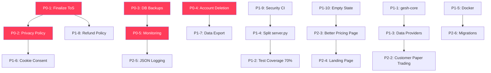

# GESH Financial — Product Roadmap

> **Canonical.** A second, independently written audit of the same 2026-07-18 baseline (`dc969264`) formerly shadowed this file at the repo root; it now lives at [`docs/audits/second-pass-2026-07-18/GESH_FINANCE_PRODUCT_ROADMAP.md`](audits/second-pass-2026-07-18/GESH_FINANCE_PRODUCT_ROADMAP.md) (moved 2026-10-15). It was never reconciled after 2026-07-19; its IDs do not map to the ones here.

**Date:** 2026-07-18

---

## P0 — Immediate Blockers

> Must be resolved BEFORE continuing to accept paying customers.

| # | Task | Reason | Dependencies | Complexity | Discipline | Acceptance Criteria | Relevant Files |
|---|---|---|---|---|---|---|---|
| P0-1 | **Finalize Terms of Service** with a fintech/securities attorney | Charging customers with a doc explicitly labeled "DRAFT — not yet legally reviewed" creates legal liability | None | M | Legal/Compliance | ToS reviewed by attorney; "DRAFT" label removed; dated and versioned | [TERMS_OF_SERVICE.md](file:///Users/georgigaydarov/Projects/gesh-project/TERMS_OF_SERVICE.md) |
| P0-2 | **Create Privacy Policy** page at /privacy | Any service processing personal/financial data requires a privacy policy (GDPR, CCPA) | P0-1 (should be consistent) | M | Legal/Compliance + Backend | /privacy route serves attorney-reviewed privacy policy; linked from footer and pricing | legal_pages.py, server.py |
| P0-3 | **Implement automated database backup** | Three SQLite databases (gesh_auth.db ~508KB, gesh_financial.db ~9MB, gesh.db ~1.1MB) have no backup; evidence of past corruption (gesh_financial.db.corrupt.bak exists) | None | S | DevOps | Daily automated backup to separate location; backup verified monthly; documented restore procedure | launchd plist or cron |
| P0-4 | **Add account deletion** capability | GDPR Art. 17 right to erasure; CCPA right to deletion; no mechanism currently exists | None | M | Backend + Frontend | DELETE /api/account endpoint; confirmation UI; deletes user, positions, analyses, usage, watchlist from gesh_auth.db | auth_users.py, server.py |
| P0-5 | **Add production monitoring** and alerting | No visibility into errors, latency, or system health beyond /healthz; running blind on production | None | M | DevOps + Backend | Structured JSON logging; error tracking (Sentry or equivalent); uptime monitoring; alert on 5xx spike | server.py, infrastructure |

---

## P1 — Required Before Public Paid Launch

> Core reliability, compliance, and UX items needed for a confident commercial product.

| # | Task | Reason | Dependencies | Complexity | Discipline | Acceptance Criteria | Relevant Files |
|---|---|---|---|---|---|---|---|
| P1-1 | **Complete gesh-core extraction** or adopt monorepo | Two overlapping codebases create drift risk; CI fragility from PAT for private dependency; installation friction for contributors | None | L | Backend + DevOps | Either: (a) all shared logic in gesh-core with versioned releases and parity tests, or (b) monorepo with shared modules | kelly.py, db.py, consensus.py, trading/ |
| P1-2 | **Raise test coverage to 70%+** | Current 55% floor leaves critical paths in server.py, agents, and report generators untested | None | L | QA + Backend | pytest --cov-fail-under=70 passes; server.py core routes covered; property-based tests for Kelly/consensus | pyproject.toml, tests/ |
| P1-3 | **Add data provider abstraction** layer | Single-point-of-failure on yfinance (crumb fragility, rate limits) and robin_stocks (undocumented, pickle auth); partial fallbacks exist but inconsistently | None | L | Backend | DataProvider protocol; adapters for yfinance, future Alpaca/Polygon; circuit breaker pattern; per-symbol fallback chain | price_source.py, data_fetcher.py |
| P1-4 | **Split server.py into route modules** | 4,099-line file with 287 definitions is a maintenance, review, and onboarding burden | None | M | Backend | server.py reduced to app setup + router includes; separate auth_routes.py, billing_routes.py, portfolio_routes.py, analysis_routes.py, trading_routes.py | server.py |
| P1-5 | **Add Docker deployment** option | macOS-only self-hosted deployment limits reliability, portability, and contributor onboarding | None | M | DevOps | Dockerfile + docker-compose.yml that builds and runs the :9000 server with all dependencies; documented in README | Dockerfile, docker-compose.yml |
| P1-6 | **Add cookie consent** disclosure | Session cookie = personal data; setting it without disclosure violates ePrivacy Directive and GDPR | P0-2 | S | Frontend + Legal | Cookie banner or disclosure on login page explaining session cookie use | server.py login page |
| P1-7 | **Add data export** / portability | GDPR Art. 20 right to data portability | P0-4 | S | Backend | GET /api/account/export returns JSON with all user data (positions, analyses, usage, preferences) | auth_users.py, server.py |
| P1-8 | **Add refund policy** | Customers need to know refund terms before subscribing | P0-1 | XS | Legal/Compliance | Refund policy section added to ToS and linked from /pricing | TERMS_OF_SERVICE.md, server.py |
| P1-9 | **Add pip-audit + bandit** to CI | No dependency vulnerability scanning or security linting; known CVEs could go undetected | None | XS | DevOps + Security | CI pipeline includes pip-audit (fails on high/critical CVEs) and bandit (fails on high-confidence issues) | .github/workflows/tests.yml |
| P1-10 | **Add empty-state experience** for new customers | New customer sees owner's masked $100K model book instead of their own empty state | None | S | Frontend + Backend | Customer with no positions sees "Get started — add your portfolio" prompt, not owner's masked data | server.py, dashboard.html |

---

## P2 — Required for a Strong Commercial Product

> Automation, observability, better UX, and scaling.

| # | Task | Reason | Dependencies | Complexity | Discipline | Acceptance Criteria | Relevant Files |
|---|---|---|---|---|---|---|---|
| P2-1 | **Add password reset flow** | Users who forget their password have no self-service recovery beyond magic link | None | S | Backend + Frontend | POST /auth/reset-password sends reset email; GET /auth/reset confirms; or document magic link as the official path | auth_users.py, server.py |
| P2-2 | **Add customer paper trading** | Customers currently cannot paper trade (owner-only feature) | None | L | Backend + Frontend | Customer can run paper trades on their own book with separate P&L tracking | paper_trading.py, server.py |
| P2-3 | **Improve /pricing page** design | Current page is functional but basic (server-rendered minimal HTML) | None | S | Frontend + Design | Professional pricing page consistent with dashboard styling; feature comparison; social proof | server.py pricing_page() |
| P2-4 | **Add public landing page** | Unauthenticated visitors see only /login; no marketing/explanation page | None | M | Frontend + Product | Landing page at / (when not logged in) with product overview, features, track record link, pricing | server.py, new template |
| P2-5 | **Add structured JSON logging** | Current logging is print() + basicConfig; hard to aggregate, search, and alert | P0-5 | M | Backend + DevOps | All log output in structured JSON format; request ID correlation; log levels properly used | server.py, all modules |
| P2-6 | **Implement database migration tool** | Schema changes done via idempotent ALTER TABLE; no versioning, no rollback, no audit trail | None | M | Backend | Alembic or equivalent migration tool; versioned migrations; up/down support | auth_users.py, db.py |
| P2-7 | **Add performance metrics** for customer book | No TWR, MWR, Sharpe, max drawdown for customer portfolios | None | M | Backend | Portfolio performance page with TWR, Sharpe, max drawdown, benchmark comparison | server.py, new module |
| P2-8 | **Add server-side session invalidation** | Stateless HMAC tokens can't be revoked server-side; stolen token valid for 7 days | None | S | Backend | Session invalidation table; logout actually invalidates token server-side | auth_users.py |
| P2-9 | **Migrate CSP to nonce-based** | 'unsafe-inline' in CSP weakens XSS protection | P1-4 (easier with modular frontend) | M | Frontend + Security | CSP uses per-request nonce for inline scripts; 'unsafe-inline' removed | server.py middleware |
| P2-10 | **Add mobile responsiveness testing** | No evidence of responsive design testing or mobile UX audit | None | M | Frontend + QA | Mobile viewport testing at 375px, 414px, 768px widths; critical flows verified | dashboard.html |

---

## P3 — Future Enhancements

> Valuable features that enhance the product but are not necessary for launch.

| # | Task | Reason | Dependencies | Complexity | Discipline | Acceptance Criteria | Relevant Files |
|---|---|---|---|---|---|---|---|
| P3-1 | Add multi-currency support | Currently USD-only | None | L | Backend | User can specify currency; conversions applied to all calculations | Throughout |
| P3-2 | Add ESG scoring | No ESG data integration | None | L | Backend + Data | ESG scores from data provider; breakdown by E/S/G; coverage tracking | New module |
| P3-3 | Add stock scanner for customers | Scanner is currently owner-only | P2-2 | L | Backend + Frontend | Customer-facing scanner with filters, sorting, saved scans | market_scanner.py, server.py |
| P3-4 | Add brokerage import (beyond RH) | Currently Robinhood-only for live portfolio | P1-3 | XL | Backend + Integrations | At minimum: CSV import; aspirational: Alpaca, IBKR API integration | data_fetcher.py |
| P3-5 | Add dividend tracking and income projection | No dividend data tracked | None | M | Backend | Dividend history per holding; projected annual income; yield calculation | New module |
| P3-6 | Add multi-tier entitlements | Single tier currently; ToS mentions Observer/Trader/Desk but all get same access | None | M | Backend + Product | Feature gates by tier; tier-specific quotas; upgrade/downgrade flow | auth_users.py, billing.py |
| P3-7 | Add webhook retry dashboard | Admin can see webhook delivery history | None | S | Backend + Frontend | Admin view of webhook events, statuses, retries | billing.py |
| P3-8 | Add Lemon Squeezy customer portal link | Customers can't access invoices or manage subscription directly | None | XS | Frontend | Link to LS customer portal from dashboard settings | dashboard.html |
| P3-9 | Add Android app polish | Android directories exist but app maturity unknown | None | L | Mobile + Frontend | Android app with core dashboard features | android/ directories |
| P3-10 | Add notification preferences UI | Email opt-out exists but only via link-in-email | None | S | Frontend + Backend | Dashboard settings page for notification preferences | dashboard.html, auth_users.py |

---

## Recommended Implementation Order

### Phase 1 (Weeks 1-2): Legal + Data Safety
1. P0-1: Finalize ToS
2. P0-2: Privacy Policy
3. P0-3: DB Backups
4. P0-4: Account Deletion

### Phase 2 (Weeks 2-3): Monitoring + Security
5. P0-5: Monitoring
6. P1-9: Security CI
7. P1-6: Cookie Consent
8. P1-8: Refund Policy

### Phase 3 (Weeks 3-6): Engineering Foundation
9. P1-1: gesh-core completion
10. P1-4: Split server.py
11. P1-10: Empty state
12. P1-5: Docker

### Phase 4 (Weeks 6-10): Quality + Scale
13. P1-2: Test coverage 70%+
14. P1-3: Data providers
15. P1-7: Data export
16. P2-1: Password reset
